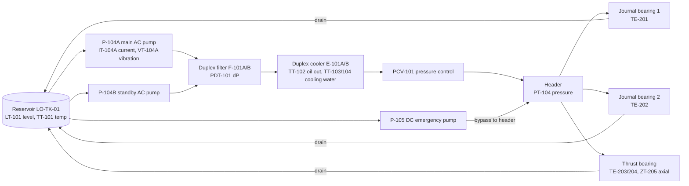
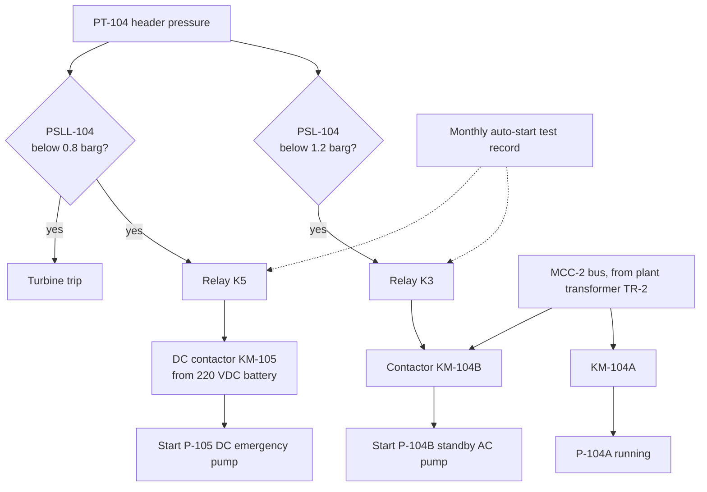

# Niche Decision and Domain Dossier: Steam Turbine Lube-Oil Systems

Written 2026-10-17. Inputs: the team's research dossiers on electrical machine niches and rotating/process equipment niches, the Optiflow scope (this repo), and the team's expertise (electrical power and mechanical/rotating).

Conventions: `[NR-0xx]`, `[NE-0xx]` and other ids cite rows in `docs/SOURCES.md`. **SITE SETPOINT (synthetic)** means a value the team defines for its fictional plant, not a standard. **ENG-LOGIC** means a deterministic rule built from physics, presented as Optiflow logic, not "the standard says". Standards are paywalled; thresholds come from opened secondary sources that quote them.

---

## 1. Decision

**Specialise Optiflow on steam turbine lube-oil systems**: the oil console that keeps a turbine's journal and thrust bearings alive. It includes the motor-driven lube-oil pumps (P-104A main AC, P-104B standby AC, P-105 DC emergency), the duplex filter, the duplex oil cooler, the header, the bearings, and the **electrical auto-start and trip circuit** that switches pumps when pressure falls.

Working name: **Optiflow LubeGuard** (or keep "Optiflow"; the niche goes in the subtitle). Tagline: "From signal to verified fix, for the oil that keeps your turbine alive."

Target customer: rotating-equipment reliability teams at JAPAC process plants that run steam turbines for power or mechanical drive, starting in Indonesia: fertiliser, petrochemical and refining, pulp and paper, palm oil and sugar mills, captive and independent power. (Sector counts for Indonesia are UNVERIFIED; the team should cite only what it can source.)

## 2. Why this niche (scoring)

Orchestrator scoring, 1 to 5, using the rubric weights as a guide (T = root-cause clarity and Gen AI fit, 40%; P = brief alignment and impact, 25%; I = differentiation given competitor density, 25%; U = phone-evidence and UX fit, 10%). Gates: team expertise, real data, 24-hour build. Transparent judgment, not the blind panel.

| Niche | T | P | I | U | Weighted | Team fit | Real-fault data | 24 h build | Verdict |
|---|---|---|---|---|---|---|---|---|---|
| **Turbine lube-oil system incl. motor-driven pumps and auto-start circuit** | 5 | 5 | 4 | 5 | **4.75** | Electrical + mechanical (both) | Weak: synthetic + UCI hydraulic proxy (CC BY 4.0) [NR-015] | Medium | **Chosen** |
| Motor + centrifugal pump trains | 5 | 4 | 2 | 5 | 4.00 | Both | Fair: NASA IMS (public domain) [NR-019], Paderborn (CC BY-NC) | Medium-low | Runner-up; crowded (Augury, KSB Guard, Tractian, ABB, SKF) [NR-021][NR-023] |
| Oil-immersed transformers | 5 | 1 | 3 | 4 | 3.40 | Electrical | Weak (25 to 703 DGA rows) | Low logic, slow closure | Strong rules, low brief fit, closure takes weeks |
| Air compressors | 4 | 2 | 3 | 3 | 3.15 | Mechanical | Best: MetroPT-3, CC BY 4.0, 4 dated failures | Low | Best data, weak brief fit |
| Heat exchangers | 3 | 3 | 3 | 3 | 3.00 | Process (not the team's) | Weak | Low | Kept as a sub-module (the oil cooler) |
| Gensets | 3 | 1 | 3 | 3 | 2.50 | Both | Weak | Medium | Thin rules, low fit |

Reasons in one place:
- **The brief already lives here.** The team's case example is "P-104 Lube Oil Pump (Unit 2)", and the brief's condition-monitoring field challenge is turbine bearing lube-oil pressure falling slowly for 5 days with no notification. This niche covers 5 to 6 of the 9 brief scenarios directly: lube-oil pressure decay, P-104 bearing vibration, the motor-overheating "blame the filter" debate, oil cooler fouling, P-104 seal leak, and transmitter drift (gauge photo vs DCS tag) (team research dossier).
- **It uses both of the team's disciplines.** Mechanical: pumps, bearings, oil chemistry, filters, cooler. Electrical: pump motor current, supply unbalance, insulation temperature, and the auto-start circuit and relay logic.
- **Root causes are crisp and partly standards-based.** Published oil limits (ASTM D4378 via ExxonMobil's guide) [NR-012], bearing temperature limits [NR-013], API 614 standby-pump logic [NR-014], ISO 10816-7 pump vibration zones [NR-024], plus a pressure-path classifier that code can compute.
- **Phone evidence is natural and judgeable.** "Clear and bright" vs hazy oil is the standard visual check for turbine oils [NR-012]; filter element and gauge photos are easy for Gemini.
- **Less crowded than generic motor and pump monitoring.** Incumbents are vibration-first and machine-only; lab oil programs are monthly or quarterly and sit apart from DCS trends (team research dossier).
- **Main weakness: no public real-failure lube-oil dataset.** Mitigation: a physics-informed synthetic scenario, labelled, plus a backtest of the pressure-path classifier on the UCI hydraulic-system rig (real data, labelled pump leakage and cooler degradation, CC BY 4.0) [NR-015].

## 3. The system (what Optiflow knows about)

### 3.1 Process and instrument view

The Investigator walks this pressure path (pump, filter, cooler, control valve, header, bearings) and tests each node.

### 3.2 Electrical auto-start and trip logic

Setpoints are **SITE SETPOINTS (synthetic)** for the demo plant. The rule that the standby pump starts on low header pressure, and that the two pumps should have different drivers or separate electrical feeders, comes from API 614 as summarised in [NR-014]. A changeover failure can damage bearings within seconds [NR-014] (secondary summary).

How the agent uses it: if header pressure is drifting toward PSL-104, the agent checks the auto-start readiness chain (last test date, relay and contactor status, DC battery state) and raises a Method item if the test is overdue. If several motors on MCC-2 show supply unbalance, the cause is upstream on the bus or transformer, not P-104A (team research dossier).

### 3.3 Tag list (synthetic demo plant)

| Tag | Signal | Unit | Normal (SITE SETPOINT) | Alarm / action (SITE SETPOINT) |
|---|---|---|---|---|
| PT-104 | Lube-oil header pressure | barg | 1.6 | Low 1.2 (standby start), low-low 0.8 (DC pump + trip) |
| PDT-101 | Duplex filter differential pressure | bar | 0.3 | Change element at 1.0 |
| PT-106 | P-104A discharge pressure | barg | 4.5 | Trend only |
| IT-104A | P-104A motor current | A | 62 | Above FLA x SF (from nameplate) |
| VT-104A | P-104A bearing housing vibration | mm/s RMS | 1.8 | ISO 10816-7 zones [NR-024] |
| TT-102 | Oil temperature after cooler (supply) | deg C | 45 | High 55 |
| TT-103 / TT-104 | Cooling water in / out | deg C | 32 / 38 | Trend only |
| LT-101 | Reservoir level | % | 70 | High 78, low 60 |
| TE-201 / TE-202 | Journal bearing pad temperatures | deg C | 88 | Alarm 115, trip 125 (below the about 129 deg C practical babbitt limit [NR-013]) |
| TE-203 / TE-204 | Thrust bearing active / inactive pads | deg C | 85 | Alarm 115, trip 125 |
| ZT-205 | Thrust position | mm | 0.00 | Trend only (limits UNVERIFIED) |
| Lab | Water (Karl Fischer), ISO 4406, TAN, viscosity, RPVOT | various | Last monthly sample | ASTM D4378 limits [NR-012] |

## 4. Failure-mode library mapped to the 4M+1E matrix

| # | Failure mode | Signature (rule) | Matrix category | Evidence the agent requests |
|---|---|---|---|---|
| F1 | Filter clogging (particles or sludge) | PT-104 down, PDT-101 up, PT-106 flat (R-T5) | Machine (filter) | Filter element photo after changeover |
| F2 | **Water ingress** (leaking oil cooler, gland steam, condensation [NR-012]) | LT-101 creeping up, hazy oil, filter loading; water above 0.1% (1,000 ppm) for steam turbines [NR-012] | Material (oil) and Machine (cooler) | **Oil sample in a clear bottle (clear and bright vs hazy)** [NR-012]; hot-plate crackle test video |
| F3 | Pump wear or relief valve passing | PT-104 down, PDT-101 flat, PT-106 down, IT-104A flat or down (R-T5) | Machine (pump) | Relief valve check, pump vibration |
| F4 | External leak | PT-104 down, LT-101 down (R-T5) | Machine (piping) | Leak photo along the oil path |
| F5 | Oil cooler fouling | TT-102 up at same load, cooling-water delta-T shrinking (ENG-LOGIC; cooler sub-module) | Machine (cooler) / Environment (cooling water) | Cooling-water gauge photos |
| F6 | Standby pump fails to auto-start | PT-104 dips below PSL without P-104B start; overdue test record (R-T4) | Method (testing) / Machine (relay, contactor) | Last auto-start test record; relay panel photo |
| F7 | Oxidation and varnish | RPVOT falling toward 25% of new with TAN rising [NR-012]; membrane patch dark | Material | Membrane patch photo (lab value still needed) |
| F8 | P-104A bearing degradation | VT-104A rising through ISO 10816-7 zones [NR-024]; BPFO/BPFI from bearing geometry [NR-005] | Machine (pump) | Nameplate and bearing designation photo |
| F9 | Motor overheating, mechanical vs cooling vs supply | R-P8 and R7: current rise with load = mechanical/hydraulic; temperature rise at baseline current = cooling; %VU above 1% = supply [NR-004] | Machine / Environment / Material (power quality) | Fan cowl photo, nameplate photo, MCC bus readings |
| F10 | Transmitter drift | PT-104 disagrees with the local gauge reading | Method (instrumentation) | Local gauge photo (Gemini reads the dial) |
| F11 | Foaming or air entrainment | Foam above 450/10 ml (ASTM D892 Seq I) [NR-012]; sight-glass foam | Material | Sight-glass photo |
| F12 | Bearing wipe (consequence) | Pad temperature rising toward the babbitt limit [NR-013] | Machine (bearing) | Not a request: an escalation |

## 5. Diagnostic rules (code, not the LLM)

| Rule | Logic | Source |
|---|---|---|
| R-T1 Oil limits | Viscosity +/-5% of new; TAN caution 0.1 to 0.2 mg KOH/g over new, warning 0.3 to 0.4 over new; RPVOT at 25% of new; water above 0.1% (steam turbines); ISO 4406 target 18/16/13 or better; foam above 450/10 ml | ASTM D4378 as tabulated by ExxonMobil [NR-012] |
| R-T2 ISO 4406 code | Lookup of counts per ml at 4/6/14 um (code 18 = 1,300 to 2,500 per ml above 4 um) | [NR-012] |
| R-T3 Bearing temperature | Practical tilting-pad babbitt limit about 129 deg C; oxidation rate roughly doubles every 10 deg C (18 deg F) above 60 deg C bulk | Turbomachinery Magazine [NR-013] |
| R-T4 Standby logic | Standby pump must start on low header pressure; separate drivers or feeders; flag if PT-104 crossed PSL with no start event, or if the auto-start test is older than the SOP interval | API 614 summary [NR-014]; SOP interval is a SITE SETPOINT |
| R-T5 Pressure-path classifier | Linear slopes over the window for PT-104, PDT-101, PT-106, IT-104A, LT-101, TT-102: (down, up, flat) = filter; (down, flat, down) = pump or relief valve; level down = external leak; level up plus haze = water ingress; TT-102 up = hot oil / cooler; sensor vs gauge mismatch = drift | ENG-LOGIC (team research dossier) |
| R-P1 Pump vibration | ISO 10816-7 zones, Category I (power plant duty) up to 200 kW: A 2.5, B 4.0, C 6.6 mm/s RMS; alarm about 5.0, trip about 8.3 | Europump reproduction [NR-024] |
| R-P5 Bearing frequencies | BPFO = (n fr/2)(1 - (d/D)cos phi), BPFI = (n fr/2)(1 + (d/D)cos phi); self-check BPFO + BPFI = n fr | [NR-005] |
| R-P8 / R7 Motor overheating debate | Current and kW rise with flow = hydraulic load; temperature up at baseline current = cooling; current up at constant flow and head = mechanical drag; %VU above 1% or current unbalance above 6% = supply | (team research dossier), NEMA MG-1 via [NE-004] |
| R4 Voltage unbalance | %VU = 100 x max deviation from average / average; above 2% unacceptable; derating 0.88 at 3.13% | NEMA MG-1 via [NE-004] |
| R5 Insulation life | Winding life halves per 10 deg C above class limit | [NE-004] |

Every rule output carries its source id so the Investigator can cite it. Gemini never computes these numbers.

## 6. Demo scenario: "the night the oil turned hazy" (synthetic, labelled)

| Day | What the data shows | What a human would see |
|---|---|---|
| 0 | Cooler E-101A develops a small tube leak; cooling water starts entering the oil | Nothing |
| 1 to 5 | Water rises from about 150 ppm to about 1,800 ppm (above the 1,000 ppm limit [NR-012]); LT-101 creeps from 70% to 72%; PDT-101 climbs from 0.3 to 0.9 bar as emulsified sludge loads the element; PT-104 falls from 1.6 to 1.3 barg (still above the 1.2 barg alarm, so the static alarm stays green); TE-201 rises 6 deg C; IT-104A and VT-104A stay flat | Operator log on day 4: "filter dP high, change filter next shift" |
| 5, 02:00 | Optiflow opens a case | |

Investigator reasoning, in order:
1. Detection: 3 of 4 lube signals anomalous (TimesFM per signal); not sensor drift (signals move together physically).
2. R-T5: PT-104 down, PDT-101 up, PT-106 flat = filter loading. **Why is the filter loading this fast?** LT-101 rising = something is adding volume to the oil.
3. Matrix: Machine (filter) NG; Machine (pump) G (current and vibration flat, R-P1 zone A); **Material (oil) UNVERIFIED**: last lab sample 3 weeks ago was normal. Request: "Take an oil sample from the reservoir drain into a clear bottle and photograph it against a light."
4. Auto-start readiness (electrical): PT-104 margin to PSL-104 is 0.1 bar; the last P-104B and P-105 auto-start test was 47 days ago against a 30-day SOP interval. **Method NG: auto-start test overdue.**
5. **Hero:** the technician's photo shows hazy, milky oil plus a voice note in Bahasa ("Olinya keruh, seperti susu"). Gemini judges "not clear and bright: suspected free water" [NR-012]. Material flips to **NG**; root cause updates to **cooling water leaking into the oil through cooler E-101A, emulsifying it, loading the filter and starving the header**. "Change the filter" alone would have treated the symptom.

Advisor actions (quadrants and costs computed in code):

| Action | Quadrant | SOP citation (synthetic SOPs) |
|---|---|---|
| Switch to filter F-101B under load | Quick Win (shift) | SOP-LO-02 section 3.1 |
| Isolate cooler E-101A, run on E-101B | Quick Win (shift) | SOP-LO-03 section 2 |
| Run the auto-start test on P-104B and P-105 now | Quick Win (safety, shift) | SOP-LO-05 section 2 |
| Start the oil purifier or vacuum dehydrator until water is below 500 ppm (SITE SETPOINT) | Major (plant) | SOP-LO-06 section 4 |
| Plug or retube cooler E-101A at the next planned shutdown | Major (plant or HO) | SOP-LO-03 section 5 |

Intervention window: actions 1 to 3 now (no downtime). Cooler repair at the next shutdown vs run to failure; exposure = median downtime of similar bearing-wipe incidents x US$29,721 per hour (problem brief), assumptions shown.

Verification: replayed post-repair data shows PT-104 back to 1.6 barg on F-101B, PDT-101 normal, water falling under the purifier, TE-201 back to baseline. Case closes as **Verified effective** and is written back as the top similar incident.

The sentence judges should repeat: **"It refused to guess, asked for one photo of the oil, and found the leak behind the clogged filter."**

## 7. Data plan for the niche

| Data | How | Licence |
|---|---|---|
| Lube-oil console time series (14 days, 1-min) for the scenario plus 5 other fault scenarios for the eval | Team-written physics-informed generator: header pressure = pump discharge - filter dP - line losses; filter dP grows with contamination rate; contamination rate rises with water ppm; level rises with water ingress; bearing temperature rises as header pressure falls | Own work, labelled synthetic |
| **Real-data backtest of R-T5** (Tier 1.5: after H8 if on track) | UCI "Condition monitoring of hydraulic systems": 2,205 cycles; labelled cooler condition (3/20/100%), valve condition, internal pump leakage (0/1/2), accumulator pressure; pressure, flow, temperature, motor power, vibration sensors [NR-015] | CC BY 4.0 [NR-015] |
| Bearing degradation shape (optional) | NASA IMS run-to-failure bearings [NR-019] | Public domain (US government work) |
| Oil photos | Staged by the team: clear new turbine oil, oil shaken with water (hazy), dark oxidised oil, foamy oil; filter element; local gauge | Own assets, labelled "staged sample" |
| SOPs and incidents | 6 to 8 synthetic SOPs (SOP-LO-01 to 08); 40 to 60 synthetic incidents covering F1 to F12 | Own work, labelled synthetic |

## 8. Competitors in this niche and the defensible difference

| Competitor | What they do (as read) | Optiflow LubeGuard's difference |
|---|---|---|
| Oil-supplier lab programs (for example ExxonMobil's turbine oil monitoring) [NR-012] | Periodic lab analysis with limits | Fuses lab limits with live DCS slopes and an on-the-spot technician photo; acts in the days between monthly samples |
| Augury, KSB Guard, Tractian (pump and motor monitoring) [NR-021][NR-023] | Machine-level vibration-first monitoring and anomaly detection | System-level: the whole oil path plus the electrical auto-start chain, with a cited 4M+1E verdict, costed timing and data-verified closure |
| Concorde, Cognite, Siemens Industrial Copilot, Hitachi (team competitor notes) | General plant knowledge graphs and copilots | One machine class modelled deeply (tags, failure modes, rules, circuit), not a general graph |
| Turbine OEM remote monitoring, Emerson AMS | Not researched (UNVERIFIED) | Do not make claims about them |

No "first" or "only" claims. Use "not described on the pages we read".

## 9. Brief mapping (what to show the judges)

| Brief scenario | Covered by |
|---|---|
| Turbine bearing lube-oil pressure dropping slowly for 5 days | Hero scenario (R-T5, R-T3) |
| P-104 rising bearing vibration | F8 (R-P1, R-P5): eval case and appendix |
| Motor overheating debate (filter vs mechanical load) | F9 (R-P8, R7): eval case; the hero scenario also contains a "blame the filter" debate |
| Heat exchanger fouling | F5 (oil cooler): eval case |
| Mechanical seal leak | P-104 seal (R-P7, leak photo): eval case |
| Transmitter drift | F10 (gauge photo vs PT-104): eval case |
| Steam header drop / alarm flood, reactor drift, pipe clamp leak | Out of niche: roadmap slide |

## 10. Items to verify before the deck says "per standard"

- ISO 10816-7 values against the purchased standard [NR-024 is a reproduction].
- ASTM D4378 limits as used by the site's oil supplier [NR-012 is ExxonMobil's table].
- All SITE SETPOINTS are marked synthetic in the UI and README.
- UCI backtest result: report the measured number only, with n.
