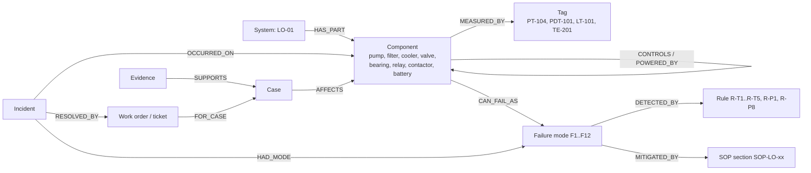
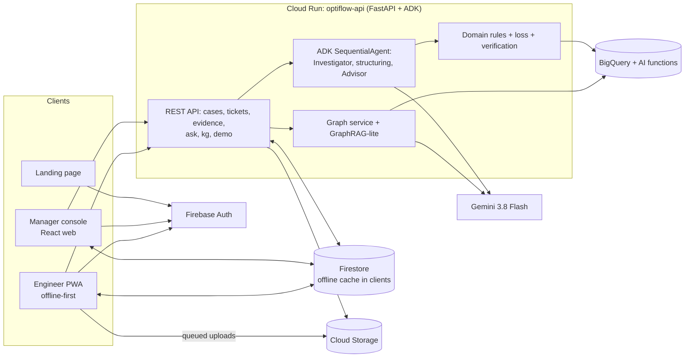

# PRD: Optiflow LubeGuard

| | |
|---|---|
| Product | **Optiflow LubeGuard**: reliability intelligence for steam turbine lube-oil systems |
| Version | v1.0 (17 Oct 2026) |
| Status | v1.0 draft for team review |
| Theme | Manufacturing: Intelligent Operations & Industrial Efficiency (Google Cloud AI Builder Cup 2026) |
| Engine source of truth | `scope-final-optiflow.md` (Optiflow repo, SHA b035069), improved here |
| Inputs | Benchmark `docs/BENCHMARK.md`; niche dossier `docs/NICHE_DECISION.md`; sources `docs/SOURCES.md`; plus the team's internal research notes (scope red team, Google stack verification, design audit of the earlier prototype) |
| Hackathon deadline | 18 Oct 2026 (confirm exact time); release R0 must be live and submitted by H21 |

## 1. Problem

Steam turbines in process plants and power units depend on a lube-oil system: pumps, filters, coolers and a header that keep the journal and thrust bearings floating on oil. When that system degrades slowly, nobody notices until it is too late:
- Static DCS alarms catch only threshold crossings. The team's problem brief describes turbine bearing lube-oil pressure falling slowly for 5 days with no notification, at a plant that lost **US$67.2M over 2,261 downtime hours (US$29,721 per hour)** (cite the brief; check figures against its text).
- Lab oil samples come monthly or quarterly and sit apart from live trends [NR-012].
- The default response to rising filter differential pressure is "change the filter", which treats symptoms (for example water ingress from a leaking cooler) instead of causes.
- Standby and emergency pump auto-start tests slip, although a failed changeover can damage bearings within seconds [NR-014].
- Work is coordinated in chats and spreadsheets; tickets close without proof that the fix worked.
- Field engineers work in turbine halls and basements where mobile signal is unreliable (assumption to validate with users), so cloud-only apps fail exactly where evidence is collected.

General platforms (Concorde-style plant graphs, generic predictive-maintenance copilots) cover the whole plant shallowly. Their root causes stay generic because they do not model the physics, failure modes and control circuit of one system.

## 2. Vision and positioning

"From signal to verified fix, for the oil that keeps your turbine alive."

Optiflow LubeGuard treats every lube-oil deviation as a **case that must be proven, priced and verified**:
- **Proven:** a root-cause matrix (Man, Machine, Method, Material, Environment) where each category is Good, Not Good or Unverified, backed by cited rules and evidence. When evidence is missing, the system asks the field engineer for it.
- **Priced:** exposure and the cheapest intervention window, computed by code.
- **Verified:** the case closes only when header pressure, filter differential pressure and bearing temperatures return to baseline.

It does this for **one system modelled deeply** (tags, failure modes, standards-based rules, the electrical auto-start circuit) and wraps it in the workflow plant teams need: a **Manager console** for planning and dispatch, and an **offline-first Engineer app** for the field. A **knowledge graph** of the lube-oil system links everything.

Benchmark summary (full matrix in `docs/BENCHMARK.md`):

| Source | What we take |
|---|---|
| Concorde Systems | Role separation (manager and technician), work-order model and statuses, PM schedules, checklists, a grounded assistant that cites and refuses, the knowledge graph as single source of truth, leadership KPIs, one-department pilot model |
| Proteus Guardian (team's earlier prototype) | Visual language and component patterns (dark industrial UI, landing page anatomy, dashboard composition, machine schematic view, voice chat, PDF export), re-created in the new repo |
| Optiflow scope | Case-centric engine, numbers by code, 4M+1E with Unverified, loss meter, intervention window, verified closure, trust layer |
| Niche research | Steam turbine lube-oil system: tags, failure modes F1 to F12, rules R-T1 to R-T5, R-P1, R-P8, auto-start circuit, "hazy oil" scenario, UCI real-rig backtest |

Differentiation statement (defensible only): "We did not find, on the public pages we read of Concorde, Cognite, Siemens Industrial Copilot, MaintainX or Hitachi, an end-to-end loop that asks the technician for missing evidence, times the fix by expected cost, closes on sensor proof, and models one machine system including its control circuit." No "first", "only" or "nobody" claims.

## 3. Goals and non-goals

**Goals (R0, hackathon):**
1. One complete, live, deployed story across both roles on Cloud Run, demoable in 3 minutes.
2. Score high on the rubric: visible multi-step agents and multimodal evidence (Technical 40%); built on the brief's own scenario (Impact 25%); evidence-requesting root cause, verified closure, deep single-system model (Innovation 25%); one cohesive two-role journey (UX 10%).
3. Every number traceable to a rule, the brief, a source, the eval or labelled synthetic data.

**Goals (R1, pilot):** run on one real turbine unit's exported data at a pilot plant; push notifications; PM calendar; KPI reports; real DCS connector.

**Non-goals (R0):** multi-site, parts inventory, ERP/SAP integration, WhatsApp/Teams integration, on-prem/edge deployment, custom ML model training, other machine classes, native mobile apps (the Engineer app is a PWA).

## 4. Users and roles

| Role | Persona | Device and context | Jobs to be done |
|---|---|---|---|
| **Manager** | Dimas, maintenance and reliability supervisor, night shift | Desktop or laptop in the control room or office | See system health; open and understand cases; request evidence; create, assign and track tickets; approve actions; receive notifications; check KPIs |
| **Engineer** | Joko, field maintenance engineer | Android phone, gloves, noisy turbine hall, unreliable signal, Bahasa | See assigned tasks; follow SOP checklists step by step; capture oil photos, voice notes and gauge readings; report findings; work offline and sync later |
| Plant manager (R1) | Bu Ratna | Desktop | Read-only KPIs, exposure, verified fixes |
| Admin (R1) | Plant IT | Desktop | Users, roles, setpoints, integrations |

Permissions (R0): Manager can do everything in the Manager console, including approve. Engineer can read tasks assigned to them and write progress and evidence for those tasks. Approval of safety-critical actions is Manager-only.

## 5. Product principles

1. **Case-centric:** every module enriches one Case; both apps show the same Case from their seat.
2. **Numbers by code, reasoning by Gemini:** loss, exposure, rule verdicts, thresholds and verification are deterministic; Gemini reasons over them and explains.
3. **Unverified beats guessing:** a category without valid cited evidence is Unverified and triggers an evidence request.
4. **Grounded or silent:** the assistant answers only from retrieved graph nodes and documents, cites them, and refuses when nothing matches.
5. **Human approval at decision points:** approving actions and closing safety items.
6. **Offline-first in the field:** the Engineer app works without signal and syncs when it can.
7. **Deep, not wide:** one system modelled properly beats a generic platform.
8. **Honest data:** synthetic data and site setpoints are labelled everywhere.

## 6. Core journey (R0 hero, across both roles)

"The night the oil turned hazy" (synthetic, labelled). Domain detail in `docs/NICHE_DECISION.md` section 6.

| # | Who | Where | What happens |
|---|---|---|---|
| 1 | System | Manager: Overview | Lube-oil diagram shows PT-104 header pressure sliding from 1.6 to 1.3 barg over 5 days; static alarm (1.2 barg) still green |
| 2 | System | Manager: notification | "New case C-0412: lube-oil header pressure decay, ST-01" |
| 3 | Dimas | Manager: Incident Room | Detection (3 tags anomalous, not sensor drift); pressure-path verdict "filter loading"; exposure; agent trace; matrix: Filter NG, Pump G, Method NG (auto-start test 47 days overdue, 0.1 bar margin to standby start), **Material UNVERIFIED** with an evidence request |
| 4 | Dimas | Manager: Incident Room | Clicks "Send evidence request": a task "Oil sample photo, reservoir drain" is created and assigned to Joko (RACI suggestion), due in 30 minutes |
| 5 | Joko | Engineer app | Push or in-app notification; task appears in My Tasks (already cached) |
| 6 | Joko | Engineer app, **offline** in the turbine basement | Opens the task checklist (SOP-LO-04 section 2: sampling steps), takes a photo of the oil bottle against a light, records a voice note in Bahasa ("Olinya keruh, seperti susu"), ticks steps; the app shows "Saved offline, 2 items queued" |
| 7 | Joko | Engineer app, back online | Queue syncs: photo and voice note upload; task marked complete |
| 8 | System | Manager: Incident Room (live) | Evidence judge: "not clear and bright, free water suspected" [NR-012]; Material flips to **NG**; root cause updates to "cooling water leaking through cooler E-101A"; knowledge-graph path lights up (cooler E-101A to oil to filter F-101A to header to bearing 1) |
| 9 | Dimas | Manager: Incident Room | Advisor actions with SOP-LO citations: switch to F-101B, isolate E-101A, run auto-start test now, start purifier, retube E-101A at next shutdown; Dimas approves the first three |
| 10 | System | Both apps | Tickets created and assigned (Joko: filter switch and auto-start test; Mechanical Shift B: cooler isolation); notifications sent |
| 11 | Joko | Engineer app | Executes checklists, records the auto-start test result and the new filter dP gauge reading (photo, Gemini reads the dial) |
| 12 | System | Manager: Incident Room | Replayed post-repair data: PT-104 back to 1.6 barg, filter dP normal, bearing temperature at baseline: **Verified effective**; the case is written back to the graph as a verified fix |

The judge-facing sentence: "It refused to guess, asked the engineer for one photo of the oil, even with no signal, and found the leak behind the clogged filter."

## 7. Scope and releases

Priority: **P0** = R0 must ship; **P1** = R0 only if the H12 checks pass, otherwise R1; **P2** = later.

| Area | R0 (hackathon) | R1 (pilot, 6 to 8 weeks) | R2 (scale) |
|---|---|---|---|
| Landing page | P0 | Refresh with pilot results | |
| Auth and roles | P0 (Firebase Auth, demo entry per role) | SSO, admin | Multi-org |
| Manager: Overview and Incident Room | P0 | Multi-unit | Multi-site rollup |
| Manager: Tickets and assignment | P0 | SLA timers, escalation | SAP PM sync |
| Manager: Notifications (in-app) | P0 | Push (FCM), email | WhatsApp/Teams |
| Manager: PM schedule | P1 (list of lube-oil PM templates) | Calendar, auto-generation | |
| Manager: Knowledge graph view | P0 (case path highlighted) | Full explorer, editing | Graph import from P&ID |
| Ask LubeGuard (grounded assistant) | P0 (text, case-scoped and system-scoped) | Voice in Bahasa for engineers | |
| Manager: KPI board and PDF report | P1 | P0 | Board-ready exports |
| Engineer app: tasks, checklists, evidence, offline sync | P0 | Native wrapper if needed | |
| Detection and domain rules | P0 | Real DCS connector (Pub/Sub) | Other turbine auxiliaries (seal oil, control oil) |
| Agents (Investigator, Advisor), evidence judge | P0 | Prompt and rule tuning on pilot data | |
| Intervention cost comparison | P1 (simple rule text is P0) | Full optimizer | |
| Verification and write-back | P0 | | |
| Eval and real-rig backtest | Eval P0, UCI backtest P1 | Pilot accuracy report | |

## 8. Functional requirements

### 8.1 Landing page (LND)

| ID | Requirement | P |
|---|---|---|
Structure follows the Proteus Guardian landing anatomy (audit section 2), re-drawn for LubeGuard, plus the sections Proteus lacked.

| ID | Requirement | P |
|---|---|---|
| LND-01 | Sticky glass navbar (`dark-900/80` with backdrop blur): wordmark, section links, "Enter as Manager" button | P0 |
| LND-02 | Hero: eyebrow pill (category: "Turbine lube-oil reliability"), two-line headline with a cyan-to-blue gradient second line, one-sentence sub-copy, two pill CTAs "Enter as Manager" (primary, white glow) and "Enter as Engineer" (secondary); cyan glow blob behind | P0 |
| LND-03 | Product preview in a fake browser frame: re-drawn LubeGuard Manager view with the lube-oil diagram, header pressure, filter dP, bearing temperature, water ppm, an "AI insight" card citing an SOP section, and an open work-order list | P0 |
| LND-04 | Stats band with **real, cited numbers only** (brief cost per hour with arithmetic; Siemens downtime figure [CC3-001]) | P0 |
| LND-05 | Three value cards: Proven, Priced, Verified (glass cards, cyan, purple, green accents) | P0 |
| LND-06 | Two-role split: Manager console and offline Engineer app, with screenshots | P0 |
| LND-07 | Five-step flow: detect, request evidence, field check (photo and voice, offline), approve and assign, verify | P1 |
| LND-08 | "The system we model": lube-oil skid and auto-start circuit, plus knowledge graph and citations | P1 |
| LND-09 | "Built on Google Cloud and Gemini" strip; glass CTA panel; footer with repo link, theme statement, "built during the AI Builder Cup", synthetic-data note | P0 |

### 8.2 Authentication and roles (AUTH)

| ID | Requirement | P |
|---|---|---|
| AUTH-01 | Firebase Authentication; role stored on the user profile (`users/{uid}.role` = manager or engineer) | P0 |
| AUTH-02 | Demo entry: one click creates a sandbox session (per-visitor case and tasks) with a demo Manager or Engineer identity; "Reset demo" button | P0 |
| AUTH-03 | Role-based routing: Manager routes to the console; Engineer routes to the PWA | P0 |
| AUTH-04 | Firestore security rules enforce role permissions (section 12) | P0 |
| AUTH-05 | Role switcher for judges ("View as Engineer" opens the engineer app for the same sandbox) | P0 |

### 8.3 Manager console (MGR)

| ID | Requirement | P |
|---|---|---|
| MGR-01 | **Overview:** lube-oil system diagram with live tag values and status colours; open cases; open tickets; KPI tiles (open cases, overdue tickets, verified fixes, current exposure) | P0 |
| MGR-02 | **Incident Room** for a case: signal chart with static alarm line; detection badge; pressure-path verdict; exposure with assumptions; agent trace panel; 4M+1E matrix with citations and Unverified states; evidence gallery; action cards with authority badges and SOP citations; Approve; linked tickets; verification status | P0 |
| MGR-03 | "Send evidence request" from an Unverified cell creates an engineer task prefilled with the request, the relevant SOP section and due time | P0 |
| MGR-04 | **Tickets:** list and kanban (Open, In Progress, On Hold, Done, Verified); fields: title, type (corrective, evidence request, preventive, safety test), asset/component, case link, priority, due date, estimated time, assignee, SOP attachments, checklist, status history | P0 |
| MGR-05 | Create ticket manually or from an approved action; assignee suggested by RACI (`asset_class x failure_mode x shift`) and overridable | P0 |
| MGR-06 | Reassign, change status, comment; status changes notify the assignee | P0 |
| MGR-07 | **Notification centre** (bell): case opened, evidence received, task completed, task overdue, verification result | P0 |
| MGR-08 | **Knowledge graph view:** interactive graph of the lube-oil system; filter by node type; the current case's root-cause path highlighted; click a node to see its tags, failure modes, SOP sections, incidents | P0 |
| MGR-09 | **Ask LubeGuard** panel: grounded answers with node and document citations; refuses when nothing matches ("0 sources, answer refused") | P0 |
| MGR-10 | PM templates list: monthly auto-start test, monthly oil sample, filter changeover, cooler inspection; generate a ticket from a template | P1 |
| MGR-11 | KPI board: created vs completed, on time vs overdue, MTTR, cases by failure mode, verified fix rate; PDF export | P1 |
| MGR-12 | Setpoints page (read-only in R0), every value labelled "SITE SETPOINT (synthetic)" | P1 |

### 8.4 Engineer app, offline-first PWA (ENG)

| ID | Requirement | P |
|---|---|---|
| ENG-01 | Installable PWA (manifest, service worker); app shell loads offline after first visit | P0 |
| ENG-02 | **My Tasks:** assigned tasks with priority, due time, asset; cached for offline use | P0 |
| ENG-03 | **Task detail and checklist:** SOP-derived steps, each citing its SOP-LO section; tick, add note, add reading; safety warnings highlighted | P0 |
| ENG-04 | **Evidence capture:** photo (camera), voice note (microphone), gauge photo with optional manual reading, numeric inputs; each item tagged to task and step | P0 |
| ENG-05 | **Offline mode:** task progress written through Firestore offline persistence; photos and audio stored in an IndexedDB queue and uploaded to Cloud Storage on reconnect; clear banner ("Offline: 2 items queued"), per-item sync state, retry | P0 |
| ENG-06 | **Report submission:** findings summary, condition rating, actions done; submits the task (queued if offline) | P0 |
| ENG-07 | Notifications: in-app list of new assignments and changes | P0 |
| ENG-08 | Glove-friendly UI: touch targets at least 48 px, large type, high contrast, Bahasa Indonesia and English | P0 |
| ENG-09 | "Use sample photo" and "Use sample voice note" for judges without an oil sample | P0 |
| ENG-10 | Ask LubeGuard by voice in Bahasa (speech to text, grounded answer, text to speech) | P1 |
| ENG-11 | Push notifications via Firebase Cloud Messaging | P1 |

### 8.5 Intelligence (AI)

| ID | Requirement | P |
|---|---|---|
| AI-01 | Per-signal anomaly detection on lube-oil tags with TimesFM in BigQuery (`AI.DETECT_ANOMALIES`), plus a 2-of-3 physical agreement check against sensor drift | P0 |
| AI-02 | Domain rules as services with source ids: R-T5 pressure path, R-T1 oil limits, R-T2 ISO 4406, R-T3 bearing temperature, R-T4 auto-start readiness, R-P1 pump vibration, R-P8 and R4 motor; loss and exposure; verification | P0 |
| AI-03 | **Investigator agent** (ADK, `gemini-3.8-flash`) with tools: `query_signals`, `classify_pressure_path`, `get_oil_lab_results`, `check_autostart_readiness`, `get_asset_context`, `get_pump_motor_health`, `search_similar_incidents`, `get_field_evidence`, `get_graph_neighbourhood` | P0 |
| AI-04 | Structuring step returns a Pydantic-validated `RootCauseMatrix`; code downgrades any verdict without a valid citation to Unverified; Unverified categories produce an evidence request | P0 |
| AI-05 | **Evidence judge:** photo and voice note judged against the turbine-oil checklist (clear and bright vs hazy or milky, dark, foam, particles) [NR-012]; gauge photos read to a value; clear-oil controls must return Good | P0 |
| AI-06 | **Advisor agent:** actions mapped to Not Good categories, each step citing an SOP-LO section validated in code; authority badge (shift, plant, HO) from a table; simple timing rule (now vs next shutdown) | P0 |
| AI-07 | **Ask LubeGuard:** GraphRAG-lite (section 9); citations as node ids and SOP sections; refusal on empty retrieval | P0 |
| AI-08 | Intervention cost comparison (now, next shutdown, run to failure) | P1 |
| AI-09 | Time-to-threshold with `AI.FORECAST` (linear slope projection is P0) | P1 |
| AI-10 | Eval harness over 15 to 20 golden cases with negative controls; metrics in README and deck | P0 |
| AI-11 | UCI hydraulic-rig backtest of the pressure-path classifier (CC BY 4.0) [NR-015] | P1 |

### 8.6 Notifications (NOT)

| ID | Requirement | P |
|---|---|---|
| NOT-01 | Firestore `notifications` collection with realtime listeners in both apps; unread counts | P0 |
| NOT-02 | Events: case opened, evidence requested, evidence received, task assigned, task completed, task overdue, action approved, verification result | P0 |
| NOT-03 | Web push via Firebase Cloud Messaging | P1 |
| NOT-04 | Email, WhatsApp, Google Chat | P2 |

## 9. Knowledge graph

**Purpose:** a single, explainable model of the lube-oil system that the agents, the assistant and both apps read. Inspired by Concorde's "one graph" principle, but domain-specific.

| Aspect | R0 | R1 |
|---|---|---|
| Storage | BigQuery tables `kg_nodes(id, type, label, props)` and `kg_edges(src, dst, type)`; in-memory graph in the API for traversal | Spanner Graph (free trial: 90 days, 10 GB, regional configs incl. Jakarta) [CC2-002][CC2-003] |
| Build | Seeded from the tag list, the P&ID and auto-start circuit (authored as JSON), failure-mode library and rules; SOP sections parsed with Gemini into `SOPSection` nodes; incidents linked by failure mode | P&ID image to graph with Gemini vision, human review |
| Retrieval (GraphRAG-lite) | Start from the case's affected component (or entities found in the question), take the k-hop neighbourhood (k = 2), add top similar incidents (vector search) and SOP sections; Gemini answers only from this context; citations are node ids; empty context gives a refusal | Hybrid graph plus vector retrieval with ranking |
| View | Interactive graph (for example Cytoscape.js) with the root-cause path highlighted | Editing, version history |
| Write-back | Verified fixes become `Incident` nodes with `capa_effective = true` | |

## 10. Data model

Firestore (operational, realtime, offline):

| Collection | Key fields |
|---|---|
| `users` | role, name, shift, sandbox_id |
| `cases` | asset, status, detection, impact, diagnosis (matrix, evidence ids), decision (actions, approvals), verification, audit_trail |
| `tickets` | type, title, case_id, asset, priority, due, estimate_min, assignee, status, status_history, checklist (steps with SOP refs), attachments |
| `tickets/{id}/progress` | step_id, done, note, reading, by, at (written offline) |
| `evidence` | ticket_id, case_id, kind (photo, voice, gauge), storage_uri, upload_state, judged (verdict, reason, confidence) |
| `notifications` | to_uid, event, ref, read, at |
| `pm_templates` (P1) | name, interval_days, checklist |

BigQuery (analytics, rules, graph): `lube_readings`, `anomalies`, `oil_lab`, `autostart_tests`, `setpoints`, `asset_master`, `incidents` (with embeddings), `sop_chunks`, `kg_nodes`, `kg_edges`, `raci`, `authority`, `eval_results`, `uci_backtest` (P1).

Cloud Storage: `evidence/{sandbox}/{ticket}/{file}`, 30-day lifecycle for demo data.

## 11. Architecture

- One Cloud Run service serves the API, agents and static web builds (landing, Manager console, Engineer PWA). Firebase is used for Auth and Firestore (allowed by the rules); hosting stays on Cloud Run for one deploy path.
- Google services used, each with a clear job: Gemini 3.8 Flash, ADK, Cloud Run, BigQuery (with `AI.DETECT_ANOMALIES`, `AI.EMBED`, `VECTOR_SEARCH`), Firestore, Firebase Auth, Cloud Storage. P1: Firebase Cloud Messaging, Pub/Sub BigQuery subscription, `AI.FORECAST`, Spanner Graph.

### 11.1 Offline-first design (Engineer app)

| Concern | Design |
|---|---|
| App shell | Service worker caches the built assets; the app opens without network after the first visit |
| Data | Firestore web SDK with `persistentLocalCache` (multi-tab manager); assigned tickets and checklists are read on login and stay cached; listeners serve cached data offline (`metadata.fromCache`) [S007] |
| Writes offline | Checklist progress, notes and readings go to `tickets/{id}/progress` and sync automatically when online; conflict policy last-write-wins per field [S007]; status transitions that need validation (complete, approve) go through the API when online and show "pending" until then |
| Media offline | Photos and voice notes saved to an IndexedDB queue (Cloud Storage uploads are not queued by the SDK); uploader retries on `online` events and app foreground; each item shows queued, uploading, synced or failed |
| Evidence processing | The API judges evidence when the upload lands and updates the case; the Manager console updates live |
| Limits | Firestore offline persistence on the web is supported on Chrome, Safari and Firefox [S007]; test on the demo phone |

## 12. Non-functional requirements

| ID | Requirement |
|---|---|
| NFR-01 Performance | Case open to matrix under 30 s (cached fallback shown after 25 s); Ask answer under 8 s; evidence judged within 15 s of upload |
| NFR-02 Offline | Engineer can complete a task with photo and voice evidence with no network; everything syncs within 30 s of reconnect |
| NFR-03 Security | Firestore rules: managers read and write their sandbox; engineers read tickets assigned to them and write progress and evidence for those; signed upload URLs; API key in Secret Manager; no real personal data |
| NFR-04 Reliability (judging window 19 Oct to 6 Nov) | min-instances 1; per-session sandboxes; Reset; cached fallbacks for every agent step; budget alert and spend cap; per-IP rate limit |
| NFR-05 Accessibility | English default with Bahasa toggle; 48 px touch targets; contrast; status shown with icon plus colour |
| NFR-06 Trust | Every AI output stores sources, model and prompt version; citation validity checked in code; Unverified when uncertain |
| NFR-07 Compliance with hackathon rules | Fresh repo and commits in the window; only Google AI and cloud in the deployed path; English materials; labelled synthetic data |

## 13. UI and design system

Visual language: inspired by the team's earlier prototype, Proteus Guardian (components re-created in this repo).

| Token | Value (from Proteus Guardian) | Use in LubeGuard |
|---|---|---|
| Neutral ramp | dark-900 `#0B0E14` (page), dark-800 `#151A23` (cards, sidebar), dark-700 `#232D3F` (borders, dividers); **add the missing dark-600 and dark-500** (used in Proteus but never defined, so borders fell back to light grey) | Same, with a complete ramp |
| Primary accent | cyan `#06B6D4`, glow `0 0 15px rgba(6,182,212,0.3)` on primary actions only | Primary buttons, active nav, live values, chart series 1, diagram flow |
| AI accent | purple `#8B5CF6` | AI provenance chips, agent trace, Ask panel, AI insight cards |
| Status | success `#10B981`, warning `#F59E0B`, danger `#EF4444`; pill recipe text-400 on bg-900/20 with border-900/30 | Good, Unverified, Not Good (always with an icon) |
| Typography | Proteus used the system stack with heavy bold, mono for IDs and values, 10 px uppercase micro labels | Same hierarchy; add a webfont (for example Inter plus JetBrains Mono) |
| Radius | 8 (buttons, inputs, chips), 12 (cards), 16 (modals), full (pills) | Same |
| Surfaces | Glass overlays `dark-900/80` with backdrop blur; glow blobs on marketing pages only | Same |
| Icons, motion, charts, toasts | lucide-react, framer-motion, recharts (dashed dim grid, gradient areas, custom tooltip), react-hot-toast | Same libraries, new components |

Screen inventory (R0): Landing; Manager: Overview, Incident Room, Tickets (list and kanban), Ticket detail, Knowledge Graph, Ask panel, Notifications; Engineer: My Tasks, Task detail and checklist, Evidence capture, Sync status, Notifications.

### 13.1 Patterns re-created from Proteus Guardian (per surface)

From the team's design review of the earlier prototype. Components are re-created in this repo.

| Surface | Pattern from Proteus Guardian | LubeGuard version |
|---|---|---|
| Manager shell | Collapsible sidebar with glowing active pill | Sidebar plus a new top bar: search, notification bell, user and role menu |
| Manager Overview | KPI StatCard row (micro label, icon tile, big number, subtext) | Open cases, overdue tickets, verified fixes, current exposure |
| Manager Overview | Recent-anomalies table with row drilldown and inline resolve | Work-order table with assignee avatar, status, due time, persisted state |
| Everywhere | **Human vs AI provenance chip** (blue user icon, purple bot icon) | On every finding, evidence item, ticket and timeline event: who produced it |
| Manager Overview and Incident Room | "Single most urgent action" card | "Next best action" with the cited SOP step and a "Create ticket" button |
| Manager and Incident Room | SchematicView turbine panel (navy dot-grid canvas, glass info chip, donut gauge, sensor footer; dead code in Proteus) | **Interactive SVG lube-oil skid:** reservoir, P-104A/B, P-105, duplex filter, duplex cooler, header, bearing feeds; live tag chips; components coloured by status; click opens a component drawer; root-cause path highlighted |
| Incident Room | Dashboard pieces combined | Left: event timeline with provenance chips; centre: skid diagram; right: Ask panel with citations; top: severity header with pulsing dot |
| Knowledge graph view | Dot-grid canvas, glass info chip, status colours | Graph canvas with node health colours, cyan selection glow, right detail panel |
| Modals | Create-ticket modal (uppercase micro labels, dark wells, cyan focus, disabled until valid) | Create ticket, assign engineer, send evidence request |
| Ask panel and Engineer evidence | Chat composer with segmented camera and mic control, live transcript, "Read aloud" per message | Manager: Ask with citation chips and suggested prompts. Engineer: camera and mic control for evidence; voice recorded locally and transcribed by Gemini when online |
| Charts | Recharts styling | Header pressure, filter dP, bearing temperature, water ppm, with static alarm lines |
| Reports (P1) | PDF preview overlay with branded header and signature block | Work-order completion report with photos, readings, transcript and verifier sign-off |
| Engineer app | (new) | Bottom tab bar, task cards modelled on the recommendation card, checklist rows with pass, fail and N/A, offline banner, sync badges, full-width primary buttons, large touch targets |

Dropped from Proteus Guardian: team carousel and photos, logos, invented marketing stats, emoji avatars, keyword-routed agent, AI4I CNC models, in-memory tickets and random data, non-Google hosting (Netlify, Railway, DigitalOcean, Docker Hub), undefined Tailwind tokens.

## 14. Success metrics

| Level | Metric | R0 target |
|---|---|---|
| Hackathon | Full hero journey runs end to end on the deployed URL from a clean browser and a phone | 5 of 5 runs |
| Hackathon | Offline moment works on the demo phone (capture offline, sync, case updates) | Works on video |
| AI quality | R-T5 mechanism accuracy on the golden set | Report real number |
| AI quality | Citation validity (citations pointing to real nodes or SOP sections) | At least 95% |
| AI quality | Photo verdict accuracy including clear-oil controls | At least 4 of 5 staged photos |
| AI quality | Refusal correctness on out-of-scope questions | At least 90% |
| Product (R1 pilot) | Detection lead time vs static alarm; share of cases closed with data verification; MTTR change; PM on-time rate | Baseline then improvement |

## 15. R0 build plan and budget (4 people, about 16 build hours each = 64 person-hours)

| Work package | Person-hours | Owner |
|---|---|---|
| WP0 Setup: GCP, Firebase project, Cloud Run deploy, Firestore rules, secrets | 6 | A |
| WP1 Synthetic content: lube-oil generator (hero + 3 scenarios), oil lab, auto-start records, SOP-LO-01..08, 30 incidents, graph seed JSON | 7 | P, D |
| WP2 Detection and domain rules, loss, verification | 7 | D |
| WP3 Agents: Investigator, structuring and citation validator, Advisor, evidence judge | 9 | A |
| WP4 Knowledge graph: tables, API, path highlighting, Ask LubeGuard (grounded, refusing) | 5 | A, D |
| WP5 Manager console: shell, Overview, Incident Room, Tickets, notifications | 12 | F |
| WP6 Engineer PWA: shell, tasks, checklist, evidence capture, offline queue and sync | 9 | F, A |
| WP7 Landing page and auth with demo roles | 4 | F, P |
| WP8 Eval harness and golden set | 2 | P |
| **Total P0** | **61** | 3 person-hours buffer (5%) |

This is at capacity. Cut order if behind (decide at H8 and H12):
1. Knowledge graph view becomes a static diagram with path highlight; keep Ask LubeGuard (saves 2).
2. Landing page reduced to hero, how it works, CTA (saves 1.5).
3. Tickets kanban becomes a list (saves 1.5).
4. Evidence judge for gauges dropped; photos only (saves 1).
5. Offline media queue dropped: photos require signal, task progress still works offline (saves 2; loses the offline video moment).

3-person team: apply cuts 1 to 4 from the start and keep the offline queue only if the H8 slice is on time.

Checkpoints: H0.5 deadline confirmed and Gemini plus BigQuery calls succeed; H2.5 hello world on Cloud Run; **H8 vertical slice** (case to matrix with Material Unverified, ticket created and visible on the Engineer app); H10 offline evidence round trip on the real phone; **H12 feature freeze**; H16 code freeze; **H21 submit**.

## 16. Risks

| Risk | Mitigation |
|---|---|
| Scope creep (two apps plus graph plus engine) | P0 list is fixed; cut order above; vertical slice by H8 |
| Offline sync bugs on the demo phone | Test on the real phone by H10; sample-photo fallback; record a backup video early |
| Judges confused by two apps | Video tells one story across both seats; split-screen at the hero moment |
| Synthetic data criticised | Labels everywhere; negative controls; UCI backtest if time |
| Reuse of the earlier prototype questioned | Fresh repo with commits in the window; README credit "UI inspired by the team's earlier prototype"; no copied logos, photos or models |
| Product names outdated | Use `gemini-3.8-flash`, Agent Platform names (current model and product names verified on 17 Oct 2026) |
| Live URL failure during judging | min-instances 1, sandboxes, Reset, cached fallbacks, spend cap |

## 17. Open questions

1. Exact submission deadline time and timezone.
2. Video length rule (FAQ "under 3 minutes" vs T&C "strictly three to four minutes"); plan 3:00 to 3:02.
3. Problem-brief figures and wording: confirm against the brief text.
4. Team size for the build (4 assumed).
5. Which phone is used for the offline demo (Firestore offline persistence browser support).

## 18. Appendix

### 18.1 API endpoints (R0)

| Method | Path | Purpose |
|---|---|---|
| POST | `/api/demo/session` | Create a sandbox (role, case seed) |
| POST | `/api/demo/reset` | Reset the sandbox |
| GET | `/api/cases/{id}` | Case snapshot |
| POST | `/api/cases/{id}/investigate` | Run Investigator, structuring and Advisor |
| POST | `/api/cases/{id}/evidence-request` | Create an evidence task from an Unverified cell |
| POST | `/api/evidence/{id}/uploaded` | Trigger evidence judging after upload |
| POST | `/api/cases/{id}/approve` | Approve actions; create tickets |
| GET/POST/PATCH | `/api/tickets` | List, create, update, assign |
| GET | `/api/kg/neighbourhood?node=` | Graph neighbourhood for the view |
| POST | `/api/ask` | Grounded answer with citations or refusal |
| POST | `/api/cases/{id}/verify` | Run verification on post-repair data |
| GET | `/api/eval/latest` | Eval results |

### 18.2 Glossary

4M+1E: Man, Machine, Method, Material, Environment. Header: the lube-oil supply line to the bearings. PSL / PSLL: low and low-low pressure switches. RACI: responsible, accountable, consulted, informed. SITE SETPOINT (synthetic): a value defined for the fictional demo plant.
