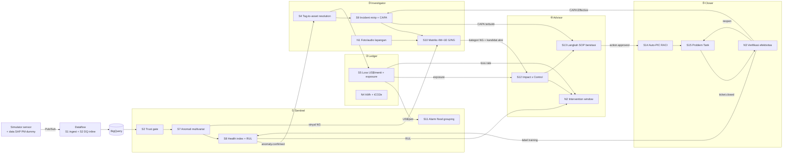
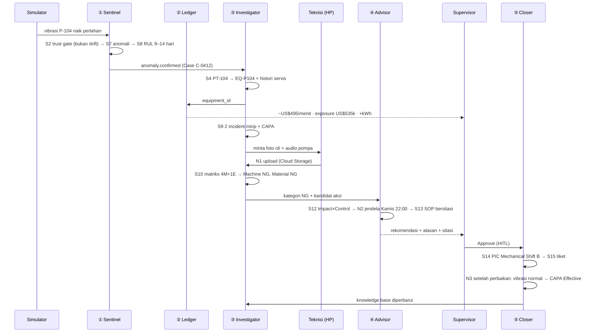

# Optiflow: Scope Final, Use Case, dan Hubungan Antar Stage

> **Tagline:** *From signal to verified fix.* Optiflow mengubah sinyal sensor yang menyimpang menjadi diagnosis berbasis bukti, keputusan yang dihitung nilai ekonominya, dan perbaikan yang diverifikasi oleh data.
>
> Turunan dari [strategi-pemilihan-stage.md](strategi-pemilihan-stage.md) dan [pipeline-mapping-gcp-repo.md](pipeline-mapping-gcp-repo.md). Dokumen ini adalah **keputusan final**. Kalau ada perubahan scope, ubah di sini dulu.

---

## 1. Keputusan Final: Stage yang Diambil

### 1.1 Ringkasan

| Status | Stage | Jumlah |
|---|---|:-:|
| ✅ **FULL**: dibangun lengkap dan ditonjolkan di demo | S5, S7, S8, S9, S10, S12, S13, N1, N2 | 9 |
| 🟡 **LITE**: dibangun versi minimal, berjalan di belakang layar | S2, S4, S11, S14, S15, N3, N4, N6 | 8 |
| 🔵 **INFRA**: ada sebagai fondasi, tidak di-pitch sebagai fitur | S1, S6 | 2 |
| ❌ **OUT**: tidak dibangun, hanya muncul di slide roadmap | S3, N5 | 2 |

### 1.2 Detail per stage

| Kode | Stage | Status | Modul | Versi yang dibangun |
|---|---|:-:|---|---|
| S1 | Data Ingestion & Integrity | 🔵 | Fondasi | Simulator Python → Pub/Sub → Dataflow → BigQuery. SAP PM & logsheet berupa data dummy di BigQuery. |
| S2 | Data Quality & Governance | 🟡 | ① Sentinel | **Trust gate**: cek flatline, out-of-span, timestamp, dan cross-check antar sensor (sensor drift vs anomali proses). |
| S4 | Asset Taxonomy | 🟡 | ③ Investigator | Tabel `asset_master` ala ISO 14224 + Gemini **entity resolution** (PT-104 ↔ P-104 ↔ "Pompa 104") dengan approval manusia. |
| S5 | Loss Quantification | ✅ | ② Ledger | Loss meter live: US$/menit aktual + **exposure** jika gagal. |
| S6 | Operational Visibility | 🔵 | UI | Dilebur jadi layar **Incident Room** + **Plant Overview**. |
| S7 | Condition Monitoring | ✅ | ① Sentinel | Anomali multivariat (BigQuery `AI.DETECT_ANOMALIES`/TimesFM + model Vertex AI). |
| S8 | Failure Early Detection | ✅ | ① Sentinel | Health index + **RUL** (Vertex AI), posisi aset di kurva P-F. |
| S9 | Historical Knowledge | ✅ | ③ Investigator | Similar-incident search (BigQuery Vector Search) + RAG CAPA/investigasi (Vertex AI Search). |
| S10 | Root Cause Verification | ✅ | ③ Investigator | Matriks **4M+1E G/NG** dari sensor + bukti lapangan + histori. |
| S11 | Alert Prioritization | 🟡 | ① Sentinel | Skenario B: 40 alarm → 1 root event + skor risiko. |
| S12 | Action Assessment | ✅ | ④ Advisor | Kuadran **Impact × Control** untuk tiap kandidat aksi. |
| S13 | Action Guidance | ✅ | ④ Advisor | Langkah mitigasi + **sitasi SOP** (grounded). |
| S14 | Action Ownership | 🟡 | ⑤ Closer | Lookup tabel RACI (`asset_class × failure_mode × shift → PIC`). |
| S15 | Action Tracking | 🟡 | ⑤ Closer | Problem Tank: Open → Repair → Maintain → Verifying → Closed. |
| N1 | Multimodal Field Evidence | ✅ | ③ Investigator | Foto/audio dari HP → Cloud Storage → Gemini multimodal → evidence G/NG. |
| N2 | Intervention Window Optimizer | ✅ | ④ Advisor | Bandingkan biaya intervensi sekarang / di jendela berikutnya / run-to-failure. |
| N3 | Fix Effectiveness Verification | 🟡 | ⑤ Closer | Pantau sinyal setelah perbaikan → CAPA *Effective* / reopen → masuk knowledge base. |
| N4 | Energy & Carbon Cost | 🟡 | ② Ledger | Kolom tambahan kWh & tCO₂e di loss meter. |
| N6 | AI Trust Layer | 🟡 | Lintas modul | Sitasi wajib, HITL approval, golden-set evaluation. |
| S3 | KPI & Relational Mapping | ❌ | — | Roadmap: "satu definisi KPI via semantic layer". |
| N5 | Shift Handover Copilot | ❌ | — | Roadmap fase 2. |

---

## 2. Arsitektur Modul & Hubungan Antar Stage

### 2.1 Konsep inti: semua modul bekerja di atas satu **Case**

Saran desain terpenting: setiap anomali yang lolos trust gate menjadi **satu objek `Case`** (dokumen Firestore + baris BigQuery). Setiap modul **memperkaya Case yang sama**, bukan membuat output sendiri-sendiri. Ini yang membuat UX terasa kohesif (kriteria *Experience & integration*) dan agent mudah dikoordinasi.

```
Case #C-0412 — P-104 Lube Oil Pump (Unit 2)
├── detection     ← ① Sentinel   (S2, S7, S8, S11)
├── impact        ← ② Ledger     (S5, N4)
├── diagnosis     ← ③ Investigator (S4, S9, S10, N1)
├── decision      ← ④ Advisor    (S12, S13, N2)
├── execution     ← ⑤ Closer     (S14, S15, N3)
└── audit_trail   ← Trust Layer  (N6): sitasi, approval, versi model
```

### 2.2 Alur antar modul



### 2.3 Matriks dependensi (siapa memberi apa ke siapa)

| Dari → Ke | Data yang dialirkan | Kenapa penting |
|---|---|---|
| **S2 → S7** | Sinyal yang sudah diberi flag kualitas (`good`/`suspect`/`bad`) | Model anomali tidak dilatih dan tidak dijalankan di data rusak. Menghindari false alarm akibat sensor drift. |
| **S7 → S8** | Fitur anomali (skor, sinyal yang menyimpang, durasi) | RUL dihitung hanya untuk aset yang sedang menyimpang. |
| **S8 → S4** | Event `anomaly.confirmed` + tag ID | Memicu pembuatan Case dan resolusi tag ke equipment. |
| **S4 → S5, S9, S14** | `equipment_id`, `asset_class`, `line_id`, kekritisan | Kunci join untuk semua modul berikutnya. **S4 adalah engsel seluruh sistem.** |
| **S5 → S11** | US$/jam per line/aset | Bobot finansial untuk skor prioritas alarm. |
| **S5 → S12, N2** | Loss rate aktual + exposure jika gagal | Impact di matriks Impact × Control dan biaya di optimizer. |
| **S8 → N2** | RUL (rentang + confidence) | Batas waktu untuk mencari jendela intervensi. |
| **S7 → S10** | Sinyal mana yang NG (vibrasi, arus motor, suhu) | Bukti sensor untuk kategori **Machine** dan **Environment**. |
| **N1 → S10** | Evidence dari foto/audio (label + deskripsi + URI GCS) | Bukti fisik untuk **Material** dan **Method**. |
| **S9 → S10** | Incident mirip + root cause terverifikasinya | Prior/hipotesis awal, sehingga investigasi tidak mulai dari nol. |
| **S10 → S12** | Kategori NG + kandidat aksi per kategori | Hanya aksi yang menyasar NG yang dinilai. |
| **S12 → N2, S13** | Aksi yang lolos (Quick Win / Major) | N2 menjadwalkan, S13 memberi langkah teknis. |
| **S9 → S13** | CAPA yang sudah terbukti efektif | Panduan mengutamakan solusi yang sudah terbukti di plant sendiri. |
| **S13 → S14** | Event `action.approved` (setelah HITL) | Tidak ada tiket tanpa persetujuan manusia. |
| **S14 → S15** | PIC (R/A/C/I) + SLA | Tiket langsung punya pemilik. |
| **S15 → N3** | Event `ticket.closed` + waktu perbaikan | Memulai jendela verifikasi. |
| **N3 → S9** | CAPA berlabel *Effective* / *Not effective* | Knowledge base makin pintar, karena hanya solusi terbukti yang diprioritaskan. |
| **N3 → S8** | Label ground-truth (failure mode, waktu) | Data retraining model (learning loop). |
| **N3 → S15** | Reopen jika sinyal tidak pulih | Mencegah recurring incident. |

### 2.4 Event contract (Pub/Sub topics)

| Topic | Publisher | Subscriber | Payload inti |
|---|---|---|---|
| `sensor.raw` | Simulator | Dataflow | `tag, ts, value, unit` |
| `sensor.validated` | Dataflow (S2) | BigQuery sink | `+ quality_flag, dq_rule` |
| `anomaly.confirmed` | Sentinel (S8) | Orchestrator | `tag, score, signals[], rul_days, confidence` |
| `alarm.flood` | Sentinel (S11) | Orchestrator | `alarm_ids[], root_event, priority_score` |
| `case.updated` | Semua modul | UI (via Firestore listener) | `case_id, section, version` |
| `action.approved` | UI (supervisor) | Closer | `case_id, action_id, approver` |
| `ticket.closed` | Closer (S15) | Closer (N3) | `ticket_id, equipment_id, closed_at` |
| `verification.result` | Closer (N3) | Investigator (S9), Vertex AI pipeline | `capa_id, effective: bool, evidence` |

### 2.5 Tabel BigQuery utama

`sensor_readings` · `tag_asset_map` · `asset_master` · `work_orders` · `incidents` · `capa` · `sop_chunks` · `alarms` · `anomalies` · `impact_ledger` · `rca_matrix` · `recommendations` · `tickets` · `raci` · `field_evidence` (URI GCS) · `eval_results`

---

## 3. Use Case per Stage Terpilih

Format: **Aktor · Pemicu · Proses (AI vs deterministik) · Output · Kriteria lulus demo.**

### ① Sentinel

**UC-S2: Membedakan sensor drift vs masalah proses**
- **Aktor:** sistem (otomatis), dilihat oleh operator.
- **Pemicu:** setiap window data masuk.
- **Proses:** aturan deterministik di Dataflow (flatline ≥ N menit, nilai di luar span instrumen, timestamp mundur). Untuk sinyal yang menyimpang, dilakukan cross-check dengan sinyal fisik terkait (misalnya tekanan reaktor naik tapi flow & suhu stabil → curiga transmitter drift). Gemini menulis penjelasan singkat.
- **Output:** `quality_flag` per data point; Case bertipe *Instrument issue* (bukan *Process anomaly*) bila terbukti drift.
- **Kriteria lulus:** dari skenario injeksi drift PT-201, sistem menandai *instrument suspect*, bukan anomali proses.

**UC-S7: Deteksi degradasi bertahap sebelum alarm statis**
- **Aktor:** operator control room.
- **Pemicu:** batch scoring tiap 5–15 menit (cukup untuk demo).
- **Proses:** `AI.DETECT_ANOMALIES` (TimesFM) per sinyal + model multivariat (autoencoder/IForest di Vertex AI) untuk kombinasi vibrasi–arus–suhu.
- **Output:** skor anomali + sinyal kontributor + tren.
- **Kriteria lulus:** penurunan tekanan oli bearing turbin / kenaikan vibrasi P-104 terdeteksi **≥3 hari sebelum** melewati batas alarm DCS.

**UC-S8: Posisi aset di kurva P-F**
- **Aktor:** reliability engineer.
- **Pemicu:** `anomaly` dengan durasi > ambang.
- **Proses:** model health index → RUL dalam bentuk rentang + confidence (Vertex AI; dilatih dari dataset bearing publik). Gemini menerjemahkan ke bahasa operasional.
- **Output:** "P-104 diperkirakan masuk zona kritis dalam 9–14 hari (confidence 0.78)."
- **Kriteria lulus:** RUL ditampilkan sebagai rentang (bukan angka tunggal) dan visual kurva P-F di Incident Room.

**UC-S11 (lite): Alarm flood → satu root event**
- **Aktor:** operator control room.
- **Pemicu:** lebih dari X alarm dalam Y detik.
- **Proses:** grouping deterministik (topologi aset dari S4 + urutan waktu), lalu Gemini merangkum root event. Skor = safety class × US$/jam (S5) × kekritisan aset.
- **Output:** "Steam header pressure drop → 37 alarm turunan. Prioritas: (1) buka valve PCV-12, (2) …"
- **Kriteria lulus:** skenario B 40 alarm tersaji sebagai 1 root event + ≤3 aksi.

### ② Ledger

**UC-S5: Loss meter live**
- **Aktor:** operator, supervisor, plant manager.
- **Pemicu:** Case aktif / rate turun di bawah target.
- **Proses (deterministik, jangan pakai LLM untuk angka):**
  - `loss_rate_aktual = (rate_target − rate_aktual) × margin_per_unit`
  - `exposure_gagal = estimasi_durasi_downtime × US$29,721/jam`, dengan durasi diambil dari median incident serupa (S9).
- **Output:** "Saat ini −US$495/menit · Exposure jika gagal: US$535k."
- **Kriteria lulus:** angka berubah live saat simulator menurunkan rate.

**UC-N4 (lite): Biaya energi & karbon dari degradasi**
- **Proses:** `Δenergi = kWh_aktual − kWh_baseline_sehat`; `tCO₂e = Δenergi × faktor emisi grid`.
- **Output:** kolom kWh/hari dan tCO₂e/hari di loss meter.
- **Kriteria lulus:** untuk heat exchanger fouling/pompa misaligned, tambahan energi tampil.

### ③ Investigator

**UC-S4 (lite): Menghubungkan tag sensor ke aset fisik**
- **Aktor:** sistem; engineer meng-approve mapping baru.
- **Pemicu:** Case baru dengan tag yang belum ada di `tag_asset_map`.
- **Proses:** Gemini membandingkan nama tag, deskripsi PI, nama equipment SAP, dan teks incident, lalu mengusulkan mapping + confidence. Mapping ≥ ambang disarankan; engineer klik Approve.
- **Output:** PT-104 → `EQ-P104` (Lube Oil Pump, Unit 2) + riwayat servis terakhir + pending work order.
- **Kriteria lulus:** operator langsung melihat "terakhir diservis 21 hari lalu, ada pending lubrication order" (field challenge Stage 1 & 4 terjawab).

**UC-S9: Incident mirip & solusi yang pernah berhasil**
- **Aktor:** teknisi, reliability engineer.
- **Pemicu:** Case terbentuk.
- **Proses:** embedding dari (deskripsi anomali + asset class + sinyal NG) → BigQuery Vector Search ke 380 incident; RAG ke dokumen investigasi/CAPA di Vertex AI Search.
- **Output:** top-3 incident mirip + root cause + CAPA + status efektivitas (dari N3) + MTTR.
- **Kriteria lulus:** kasus mechanical seal leak memunculkan incident bulan lalu yang selesai dengan "bersihkan seal flush line".

**UC-N1: Bukti lapangan dari HP**
- **Aktor:** teknisi lapangan (mobile).
- **Pemicu:** Investigator meminta bukti ("Mohon foto kondisi oli dan rekam suara pompa 10 detik").
- **Proses:** upload ke Cloud Storage; Gemini multimodal menilai terhadap checklist NG per kategori (warna oli, kebocoran, korosi, pola suara kavitasi/krepitasi).
- **Output:** evidence item `{kategori: Material, verdict: NG, alasan, uri}`.
- **Kriteria lulus:** foto oli keruh → *Material NG*; audio kavitasi → *Method/Machine NG*, dengan alasan tertulis.

**UC-S10: Verifikasi akar masalah 4M+1E**
- **Aktor:** reliability engineer, tim investigasi.
- **Pemicu:** evidence dari S7, S9, N1 tersedia.
- **Proses:** agent RCA mengambil data via tool (MCP Toolbox → BigQuery). Untuk setiap kategori Man/Machine/Method/Material/Environment, kriteria G/NG dicek dari bukti, lalu disusun **matriks verdict + bukti + confidence**. Kategori tanpa bukti ditandai *Unverified* (bukan ditebak).
- **Output:** matriks G/NG + root cause paling mungkin + kandidat aksi per NG.
- **Kriteria lulus:** kasus motor overheating: data arus motor membuktikan *Machine NG* (beban mekanis), sementara *Material (filter)* = G. Debat di field challenge terjawab dengan data.

### ④ Advisor

**UC-S12: Saring aksi dengan Impact × Control**
- **Aktor:** supervisor, maintenance planner.
- **Pemicu:** matriks NG selesai.
- **Proses:** Gemini structured output memberi skor tiap kandidat aksi. **Impact** diambil dari exposure S5 × probabilitas menyelesaikan NG. **Control** diambil dari tabel kewenangan: shift / plant / HO, butuh CAPEX atau tidak, butuh shutdown atau tidak.
- **Output:** kuadran *Quick Win / Major Project / Escalate / Deprioritize*.
- **Kriteria lulus:** "realignment pompa" masuk Quick Win, "modifikasi piping (perlu approval HO)" masuk Escalate.

**UC-N2: Kapan sebaiknya intervensi**
- **Aktor:** maintenance planner, plant manager.
- **Pemicu:** aksi Quick Win/Major dipilih.
- **Proses (deterministik + penjelasan Gemini):** untuk setiap opsi (sekarang, jendela changeover berikutnya, planned shutdown, run-to-failure), hitung `biaya_intervensi + P(gagal sebelum jendela | RUL) × exposure`, dengan constraint ketersediaan teknisi dan spare part (data dummy).
- **Output:** "Rekomendasi: Kamis 22:00 (changeover). Expected cost US$18k vs run-to-failure US$535k."
- **Kriteria lulus:** grafik perbandingan 3–4 opsi + alasan yang bisa dibaca manajer.

**UC-S13: Panduan aksi bersitasi**
- **Aktor:** operator/teknisi shift malam.
- **Pemicu:** aksi dipilih, atau pertanyaan langsung di chat ("kurangi feed rate atau backwash dulu?").
- **Proses:** RAG ke SOP (Vertex AI Search) + CAPA terbukti (S9) + konteks Case. Jawaban **wajib** menyebut nomor SOP & langkah; jika SOP tidak ditemukan → "eskalasi ke engineer on-call", bukan mengarang.
- **Output:** langkah 1–N, peringatan safety, sitasi `SOP-HX-07 §4.2`.
- **Kriteria lulus:** skenario heat exchanger memberi urutan yang benar sesuai SOP dummy + sitasi yang bisa diklik.

### ⑤ Closer

**UC-S14 (lite): PIC otomatis**
- **Proses:** lookup `raci` berdasarkan `asset_class × failure_mode × shift`; notifikasi ke R; jika tidak di-ack dalam X menit → eskalasi ke A.
- **Kriteria lulus:** setelah Approve, tiket langsung punya PIC (field challenge kavitasi tanpa PIC terjawab).

**UC-S15 (lite): Problem Tank**
- **Proses:** status Open → Repair → Maintain → Verifying → Closed; SLA timer; ringkasan Gemini per tiket.
- **Kriteria lulus:** board kanban + tiket overdue berwarna; field challenge clamp pipa bocor tidak lagi "hilang di chat".

**UC-N3 (lite): Perbaikan diverifikasi data**
- **Proses:** setelah `ticket.closed`, bandingkan sinyal 24–72 jam (dipercepat di demo) dengan baseline sehat. Jika pulih → CAPA *Effective* → diindeks ke S9 + label ke S8. Jika tidak → reopen.
- **Kriteria lulus:** fast-forward menunjukkan vibrasi P-104 kembali normal, status *Verified Effective*.

### Trust Layer

**UC-N6 (lite): AI yang bisa dipertanggungjawabkan**
- Setiap output Gen AI di Case menyimpan: sumber (SOP/incident/query), model & prompt version, confidence.
- Aksi safety-critical atau yang butuh stop line **wajib Approve** manusia.
- Golden set 20–30 skenario → ukur groundedness, akurasi kategori 4M+1E, dan ketepatan sitasi SOP → tampil di slide dan halaman "Model Card".

---

## 4. Skenario End-to-End (yang Didemokan)

| Skenario | Fungsi di pitch | Stage yang dilewati |
|---|---|---|
| **A. Degradasi bearing P-104** (utama, ±2,5 menit) | Menunjukkan alur penuh dari sinyal sampai verifikasi | S2 → S7 → S8 → S4 → S5/N4 → S9 → N1 → S10 → S12 → N2 → S13 → S14 → S15 → N3 |
| **B. Steam supply drop / alarm flood** (±30 detik) | Momen "wow" kedua, menunjukkan real-time triage | S11 (+ S5, S4, S13) |
| **C. Drift PT-201** (opsional, 15 detik) | Membuktikan sistem tidak asal alarm | S2 |

### Sequence skenario A



---

## 5. Saran

### 5.1 Prinsip desain (pegang ini selama build)
1. **Angka dihitung deterministik, Gen AI menjelaskan dan menalar.** Loss, exposure, RUL, dan optimizer **tidak boleh** keluar dari LLM. Gemini hanya membaca hasilnya dan menjelaskan. Ini menjawab pertanyaan juri soal halusinasi dan membuat angka bisa diaudit.
2. **Case-centric.** Semua modul menulis ke Case yang sama dan UI cukup mendengarkan `case.updated`. Jangan bikin 5 halaman terpisah per modul.
3. **"Unverified" lebih baik daripada menebak.** Kategori 4M+1E tanpa bukti ditandai Unverified, dan agent meminta bukti (memicu N1). Ini sekaligus jadi fitur UX.
4. **HITL di titik keputusan, bukan di setiap langkah.** Approve hanya di mapping aset baru (S4) dan eksekusi aksi (S13 → S14).
5. **Replay deterministik untuk demo.** Skenario A/B/C harus bisa diputar ulang dengan hasil identik (seed tetap, data rekaman), dengan tombol "fast-forward" untuk N3.

### 5.2 Agent design (ADK)
| Agent | Model | Tools |
|---|---|---|
| `orchestrator` | Gemini Pro | memanggil sub-agent, menulis Case |
| `sentinel_agent` | Gemini Flash (ringkasan) | BigQuery (anomali, RUL), alarm grouping |
| `investigator_agent` | Gemini Pro (multimodal + reasoning) | MCP Toolbox → BigQuery, Vector Search, Vertex AI Search, GCS reader |
| `advisor_agent` | Gemini Pro (structured output) | optimizer N2 (Cloud Run), Vertex AI Search (SOP), tabel kewenangan |
| `closer_agent` | Gemini Flash | RACI lookup, tiket (Firestore), Google Chat webhook, verifikasi N3 |

Deploy di **Cloud Run** (sesuai daftar panitia) atau **Agent Runtime** (dulu Vertex AI Agent Engine). Untuk hackathon, Cloud Run lebih sederhana dan lebih mudah di-debug.

### 5.3 UI (cukup 4 layar)
1. **Plant Overview**: peta line/aset dengan status warna + ikon, total loss live, daftar Case aktif.
2. **Incident Room** (layar utama demo): timeline sinyal + kurva P-F | loss meter | matriks 4M+1E | rekomendasi + tombol Approve | chat dengan agent.
3. **Field App (mobile web)**: daftar tugas teknisi, ambil foto/rekam suara, langkah SOP, tombol "Selesai". Input suara dalam Bahasa Indonesia.
4. **Problem Tank**: kanban tiket + status verifikasi N3.

### 5.4 Data untuk demo
- **Sensor:** simulator dengan pola degradasi yang di-inject (bearing ramp, drift transmitter, steam drop). Model RUL dilatih dari dataset bearing publik (lihat `makinarocks/awesome-industrial-machine-datasets`).
- **Histori:** ±50–100 incident sintetis (bukan 380, karena cukup untuk demo) ditambah 3–5 incident "kunci" yang ditulis manual agar skenario A/B pasti cocok. Ada generator `jvachier/industrial-maintenance-synthetic-data` sebagai titik awal.
- **Dokumen:** 5–10 SOP dummy + 5 laporan investigasi 4M+1E + tabel RACI + tabel kewenangan.
- **Angka finansial:** gunakan US$67.2M / 2,261 jam dari problem statement agar konsisten dengan brief.

### 5.5 Pembagian tim (asumsi 4 orang)
| Peran | Tanggung jawab |
|---|---|
| **Data & ML** | Simulator, Pub/Sub/Dataflow, S2 rules, S7/S8 model, S5/N4 formula, N3 verifikasi |
| **Agent & Backend** | ADK agents, MCP Toolbox, RAG (S9/S13), S10 matriks, S12/N2, event contract |
| **Frontend & UX** | 4 layar, Firestore listener, field app mobile, accessibility |
| **Domain & Pitch** | Dokumen dummy (SOP, incident, RACI), golden set N6, skrip demo, slide impact + evaluasi |

### 5.6 Urutan build
1. **Fondasi:** simulator → Pub/Sub → Dataflow → BigQuery; skema tabel & event; Case di Firestore.
2. **Vertical slice tipis:** S7 → Case → S5 → Incident Room menampilkan anomali + loss (belum ada AI agent). Tujuannya membuktikan pipa jalan.
3. **Investigator:** S4 → S9 → S10 → N1.
4. **Advisor:** S12 → S13 → N2.
5. **Closer + Trust:** S14 → S15 → N3; sitasi + approval + golden set.
6. **Skenario B (S11)**, polishing UI, rekam video demo cadangan.

> Kalau waktu mepet, yang dipotong pertama: **N4 → S11 → N2 (jadi versi tabel statis)**. Yang **tidak boleh** dipotong: S7/S8, S5, S10, S13, N1, Approve → tiket.

### 5.7 Pesan pitch (satu kalimat per kriteria)
- **Technical (40%):** "Lima agent Gemini yang bekerja di atas satu Case: memanggil BigQuery, membaca foto lapangan, bersitasi ke SOP, dan dievaluasi di 30 skenario."
- **Impact (25%):** "US$29,721 hilang setiap jam downtime. Optiflow mendeteksi lebih awal, menghitung kapan intervensi termurah, dan memastikan perbaikannya bertahan."
- **Innovation (25%):** "Akar masalah diverifikasi dengan bukti (4M+1E G/NG), keputusan dinilai ekonominya (P-F × US$), dan perbaikan dianggap selesai hanya kalau data membuktikannya."
- **UX (10%):** "Satu layar untuk control room, satu tombol kamera untuk teknisi, satu tombol Approve untuk supervisor."
